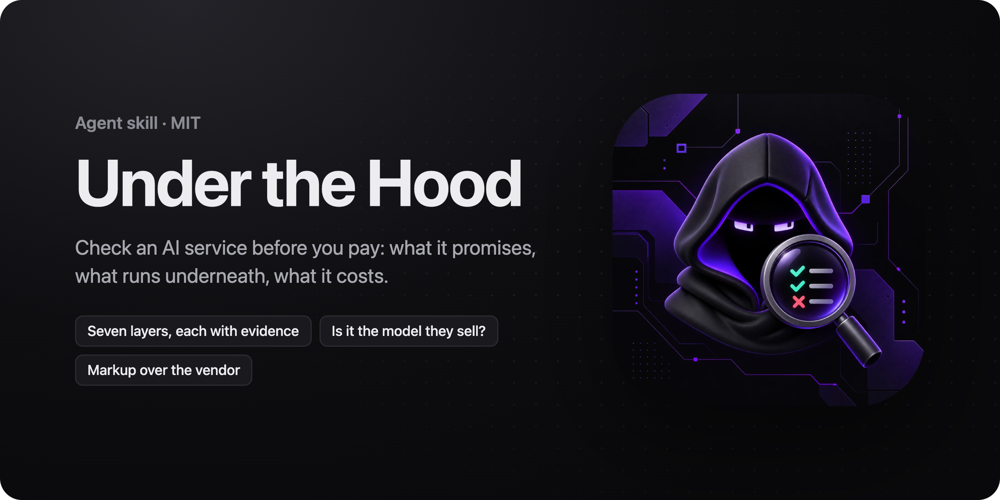
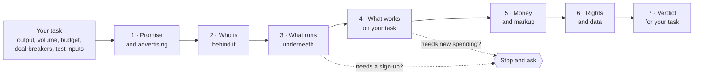

<p align="center">
  
</p>

<h3 align="center">Look under the hood before you pay.</h3>

<p align="center">
  An agent skill that checks an online service for your task before you use it or pay for it:<br />
  what it promises, which model runs underneath, what works on your input, what it costs and who owns the results.
</p>

<p align="center">
  <a href="#install"></a>
  <a href="#install"></a>
  <a href="#install"></a>
  <a href="#install"></a>
  <a href="skills/under-the-hood/scripts"></a>
  <a href="https://github.com/arez-xd/under-the-hood/actions/workflows/ci.yml"></a>
  <a href="CHANGELOG.md"></a>
  <a href="LICENSE"></a>
</p>

<p align="center">
  <a href="#quick-start">Quick start</a> ·
  <a href="#what-it-checks">What it checks</a> ·
  <a href="#is-it-the-model-they-sell">Model substitution</a> ·
  <a href="#what-does-it-cost-them">Vendor cost</a> ·
  <a href="#see-it-in-action">Example</a> ·
  <a href="#does-it-work">Evidence</a> ·
  <a href="#install">Install</a>
</p>

## Quick start

```bash
npx skills add arez-xd/under-the-hood
```

Then ask your agent:

```text
I want to generate 3D models for our product pages, about 40 a month. Compare these two 3D generators for that before I pay.
```

```text
Is this AI video studio worth the yearly plan? A friend says their Veo isn't the real one. Here's a clip I made there.
```

```text
We're about to upload client contracts to this assistant. Check where the data goes and whether it trains on it.
```

The [open skills CLI](https://github.com/vercel-labs/skills) installs into Claude Code, Codex, Cursor, GitHub Copilot and other agents; manual setup is under [Install](#install). More requests, by mode, in [`examples/prompts.md`](examples/prompts.md).

## Why

Every AI service says "our AI" and shows its best examples. Underneath there may be someone else's model behind a no-code storefront, its own model that shines in the demo and fails on your input, features that exist only on the landing page, a markup of three times the model's price, or results you don't own on the plan you're on. People find out after the annual plan is bought and the data is uploaded.

An agent asked "is this tool any good?" retells the landing page, or guesses ("probably GPT"). This skill makes it check, the way a careful buyer would: from the outside, with public data and your own account, against your own task, with a level of confidence on every conclusion.

## How it works



It works with what you have: public pages and records, files you already made with the service, your account if you have one. Using what an account already includes (free or included credits, exporting, one question to the assistant, reading prices in the app) is ordinary use. It stops and asks at two points only: before a sign-up you haven't done, and before new spending, naming the generations, the credits and the money. Without a yes it finishes on what it has, and the report says what more access would answer.

## What it checks

It starts with your task: what you need out, how much, the budget, the deal-breakers, and three to five of your own inputs to test on. Then seven layers:

| | Layer | What you learn |
|---|---|---|
| 1 | **Promise and advertising** | Every claim from the landing page, pricing, terms, app stores, demos and public ad libraries. Is the gallery cherry-picked, is "unlimited" limited, is the model in the ad the one in the product |
| 2 | **Who is behind it** | The legal entity, the age of the product, how often prices change, sibling products run by the same company |
| 3 | **Which model and which agent** | Builder platform, framework, backend, model vendors or its own models, the tools an agent really calls. Every tell has a level: *direct* (seen in requests or stated by the company), *indirect* (in the code), *guess*. And whether the model you pay for is the one you get: [see below](#is-it-the-model-they-sell) |
| 4 | **What works on your task** | Each claim: works, interface only, stub, missing, contradicted. Your test set measured by a profile for 3D generators, aggregators or assistants |
| 5 | **Money** | What your month costs on each plan, retries and expiring credits included; for aggregators, what the same generation costs at the model's vendor and the markup on each plan; how to cancel and get a refund |
| 6 | **Rights, data and trust** | Who owns the results on each plan, whether your inputs train models, retention, sub-processors, export and lock-in, each cited by clause with the deciding words quoted |
| 7 | **Verdict** | Use, use with conditions, or don't, the access the check had, and the questions to ask before paying |

Modes: **Check** (one service), **Compare** (two to four, same test set, one table), **Quick check** (fifteen minutes: is it worth a closer look).

## Is it the model they sell?

A service sells "Seedance" or "Opus" and can quietly serve something cheaper. The skill can't see the server, so it gathers what can be seen from outside and compares it with what the vendor produces, strongest evidence first:

| Evidence | What it shows |
|---|---|
| The model id in the request, a `model` field in the response | What the client asks for and what the service says it served |
| **Content credentials** (C2PA) signed by the claimed model's vendor | That this company made the file. Two tiers of one company's model carry the same signature, and a re-saved file carries the last tool's claim |
| The same seed at the vendor | Near-identical frames settle it |
| **Fingerprint of the result**: resolution, frame rate, duration, frame count, codec, audio | A 16 fps 720p clip from a model that only renders 24 fps 1080p is a strong sign |
| **Language models**: time to first token, output speed and score on a fixed task set, against both candidate models at the vendor | "Closer to Sonnet than to Opus on all three" is a finding. A model's own claim about itself counts for nothing |

It starts with the results already in your library, which cost nothing, then puts paid runs on the settings where a swap would pay most (see the next section), and asks first. The conclusion is always "consistent with X, not consistent with Y", with a question for the service.

## What does it cost them?

An aggregator sells credits; the models behind it have public prices at their vendors. The skill turns each plan's credit into dollars, prices the same generation at the vendor, and compares:

| Same 8 s clip with sound (a real check, October 2026) | At the vendor | Yearly top plan | Smallest top-up |
|---|---|---|---|
| Veo 3.1 Fast | $1.20 | 80 credits ≈ $2.04, ×1.7 | 80 credits ≈ $4.26, ×3.5 |
| Veo 3.1 | $3.20 | 205 credits ≈ $5.23, ×1.6 | 205 credits ≈ $10.91, ×3.4 |
| Veo 3.1 Lite | $0.40 | 30 credits ≈ $0.77, ×1.9 | 30 credits ≈ $1.60, ×4.0 |

`cost.mjs` prints two views. **Your month against the vendor:** the plan's total for your volume against the same runs at the vendor's prices, for any way of charging (credits, a flat fee, "unlimited", pay per use, weekly or 28-day billing). **One action at full use of each plan's credits**, with the settings where the margin is thin or negative. A high markup on the plan you'd buy is a reason to price the model at its vendor; a thin margin, usually on long, high-resolution clips and the top plan, is where serving a cheaper model would pay the service most, so that is where a paid substitution test goes.

The vendor's price can be one number, several calls added up (a pipeline), or tokens for a language model. In-app prices are read per setting without generating when the service shows them. The result is an estimate: the service's own costs and its discounts at the vendor aren't public. In a test on a live aggregator, no run without the skill compared the price with the vendor's; with the skill, two of three did ([examples](examples/blind-test/real-aggregator/README.md)).

## See it in action

A blind-test target: a made-up AI video studio with problems planted on purpose, so the example names no real company. The request, as a user would write it:

```text
Можно ли пользоваться Kadra Studio? Подумываю взять Pro на год.
Ассистент в приложении сказал, что он GPT-4, так что с моделями там вроде всё серьёзно.
```

("Can I use Kadra Studio? I'm thinking of Pro for a year. The in-app assistant said it's GPT-4, so the models seem serious.")

The verdict of a run with the skill (Opus, condensed from its claims register):

> **Decision:** don't buy the year.
>
> - **"It's GPT-4":** the assistant says so; the same API response carries `"model": "llama-3.1-8b-instant", "provider": "groq"`. A model naming itself is a guess; the response is the evidence.
> - **The model they sell:** "native 1080p, 24 fps, up to 10 seconds, with sound". A Pro generation of 10 s returned 720×1280, 16 fps, 4.0 s, no audio. Not consistent with the advertised model (indirect); a question for the service.
> - **Underneath:** a no-code builder (indirect: asset paths), Supabase (direct: requests), models via fal (indirect: ids in the bundle).
> - **Money:** "unlimited" is 1,500 credits and 50 generations a day (Terms §9); a 5-second request was charged as a 10-second one; the "today only" countdown restarts on every load; "100% money-back guarantee" against "All payments are final and non-refundable".
> - **Rights and data:** "never used to train AI" against Privacy §6; Pro outputs may be shown in the public gallery (Terms §12).
> - **Who:** the footer and the terms name two different companies.

## Does it work?

Checked with keyed blind tests: the key written before any run, isolated agents, the same request with and without the skill. Discriminating items found:

| Target | Without the skill | With the skill |
|---|---|---|
| Made-up AI video studio, one-line question (Haiku, round 2b) | 8.5 · 8.5 of 13 | **13 · 13** of 13 |
| The same, Opus | 10 (round 2) | **13** |
| Live AI video aggregator, public data only (Haiku) | 5 · 6 of 15 | **12.5 · 9** of 15 |
| The same, Opus | not run | **12.5** |

**A strong model finds a lot on its own; the skill gives it a plan.** Opus without the skill found 10 of 13, and its route decided what it found: it happened to generate a video and caught the swapped model; it named neither the backend nor the model vendor and put no level on any conclusion. It never compared the service's price with the model vendor's either, and neither did the runs without the skill on the live aggregator. With the skill, every run walks the same seven layers in the same order, measures before it concludes, marks each conclusion direct or indirect, and stops before any spending. The coverage stays the same from run to run, and the checks a model rarely thinks of on its own, the vendor's price on each plan and where a swap would pay, are part of every check.

Found only with the skill: the builder and the backend with their levels, the restarting countdown, the vendor's price against the user's plan, where a swap would pay, analytics loading before consent, the user's likely task. On a real 3D generator, only the runs with the skill found a cancellation clause that needs written consent, purchased credits valid for a year against "never expire", and training on inputs and outputs against "anonymized". Every round, its key, the grades and the limits are in [`examples/blind-test`](examples/blind-test/README.md).

## The scripts

Node 18 or newer, no dependencies. Each prints `--help` and exits 0 when done, 1 on bad input or a finding, 2 on a usage error.

| Script | What it does |
|---|---|
| `stack-scan.js` | Runs in the browser page. Builder, framework, hosting, backend, model vendors and model ids (partner ids served by a host such as fal included), payments, analytics, session recording, support; secret-shaped strings, masked. Reads only what the page loaded |
| `terms.mjs` | Pulls the sentences on ownership, commercial use, training, retention, sub-processors, refunds, renewal, credits and governing law out of the terms, with the source and the date |
| `media-meta.mjs` | Images and video: size, duration, EXIF, XMP, prompts stored in PNG text, C2PA content credentials (signer, claim generator, actions such as an applied watermark, whether an input file is listed), the IPTC AI source type |
| `fingerprint.mjs` | Is it the model they sell: video and image results against vendor references or a model profile (resolution, fps, duration, frames, codec, audio), or language-model runs against both candidate models (time to first token, speed, score) |
| `glb-inspect.mjs` | A 3D result: triangles, world-space size in metres, UVs, normals, PBR channels, texture sizes, compression, the generator field, what exceeds your budget |
| `cost.mjs` | Your month on each plan: any billing period, daily credits, "unlimited" plans, pay per use, the cheapest top-up mix. With vendor prices: your month against the vendor and each action's markup per plan |
| `claims-check.mjs` | Before hand-over: every claim has a status, evidence and a date; every vendor in the verdict has a level; no template placeholders left |
| `report.mjs` | The run folder as one readable HTML page |

## The rules

- **Read-only, with what you have.** Public data first, your own account for ordinary actions; a sign-up or new spending only when you say yes.
- **Never** calls endpoints found in the code, tries other users' IDs, opens admin routes or uses keys found in shipped files. A key in the bundle is recorded as a finding, masked, and left alone.
- **Evidence and a date** on every statement. Terms are cited by page, clause and date, with the deciding words quoted. The report is not legal advice.
- **Levels on every conclusion.** A vendor is named only from a direct tell, or an indirect one marked as such. A model naming itself in chat is a guess.
- **Scripts read, the agent quotes.** Terms, bundles and media go through the scripts; full text is read only for the clauses quoted. Fewer tokens, the same evidence.
- **Judged by what it adds.** A service built on someone else's model is judged by what it adds on top: one bill, a library, workflows, a better interface.
- **The report is for you.** If you publish it, the skill checks it first and recommends giving the company a chance to answer.

## What's inside

```
skills/under-the-hood/
  SKILL.md                  modes, the stops, rules, the seven layers, the run folder, hand-over
  references/               task, access, promise, ownership, tells, substitution, reality, money, rights-data, verdict
  references/categories/    3d, aggregators, assistants
  scripts/                  the eight scripts above
  templates/                task.md, claims.md, report.md, pricing.json, model-profile.json
  agents/                   metadata for Claude Code and Codex
examples/
  prompts.md                requests by mode
  blind-test/               rounds on a made-up service, a live aggregator and a real 3D generator
tests/                      node:test suite for every script, with fixtures
```

## Install

**Any agent, with the skills CLI:**

```bash
npx skills add arez-xd/under-the-hood
```

**By hand:** copy `skills/under-the-hood` into the agent's skills folder. Every agent below reads `SKILL.md` natively; no rule files or adapters are needed.

| Agent | One project | All projects |
|---|---|---|
| Claude Code | `.claude/skills/` | `~/.claude/skills/` |
| Codex | | `~/.codex/skills/` |
| Cursor | `.cursor/skills/` (also reads `.claude/skills/`) | `~/.cursor/skills/` |
| GitHub Copilot: VS Code agent mode, Copilot CLI, cloud agent | `.github/skills/` (also reads `.claude/skills/`) | `~/.copilot/skills/` |

The agent picks the skill up when you ask it to check a service; in Cursor you can also call it with `/under-the-hood`.

**Requirements:** Node.js 18 or newer for the scripts. A browser the agent can drive (its own browser tool, or Playwright) for in-page scans and for checking an app with your account. `ffprobe` is optional: the scripts read MP4 themselves.

## Development

```bash
npm test
```

35 tests cover every script: billing periods and the cheapest top-up mix, vendor prices as calls and tokens, C2PA parsing on a generated file, MP4 measurements on a sample clip, the world-space size of a generated GLB, the in-page scan in a sandbox, terms topics, report checks in English and Russian. CI runs them on Node 18, 20 and 22. See [CONTRIBUTING.md](CONTRIBUTING.md) for adding a tell, a profile or a fix, and [SECURITY.md](SECURITY.md) for reporting a problem.

## Limitations

- It sees what any buyer sees. Server-side routing, the company's real costs and its intentions stay invisible; they become questions in the report.
- Substitution is never proven from outside. The strongest result is "not consistent with the advertised model", plus the question.
- Vendor cost is an estimate from public prices for the same parameters. Discounts, infrastructure and failed jobs aren't public.
- Content credentials name the signing company. Tiers of one company's model look the same, and many vendors don't sign at all.
- Quality on your task needs your inputs, and paid runs need your yes; without them the verdict says what it couldn't check.
- The blind tests were written and graded by the skill's author on a few targets; the limits of each round are in `examples/blind-test`.

## FAQ

**Is it legal to check a service this way?**
It does what any customer does: reads public pages, uses your own account, saves your own results. It never calls endpoints found in the code, opens admin routes or uses someone else's account. Check the service's terms if you plan to publish what you find.

**Do I need an account?**
No. A lot can be checked from public data: the promises, the company, the stack, the prices and the markup, the terms. The skill says what an account or a paid run would add and asks before either.

**Will it spend my money?**
Only with your yes, after naming the generations, the credits and the amount. Using credits your plan already includes counts as ordinary use.

**Can it check mobile apps?**
Yes, with less to see: the store page, the privacy label, the in-app prices, the hosts the app talks to (iOS App Privacy Report or a proxy on your own computer), and your own results.

**Does it work in other languages?**
The skill and scripts are in English; the agent answers in your language, and `terms.mjs` and `claims-check.mjs` also read Russian.

**Can I publish the report?**
It's written for your decision. If you publish it, the skill checks it first: no personal data or secrets, the date and the "not checked" section kept, and the company given a chance to answer.

## Related

- [Product Audit](https://agensi.io/r/ADAMREEL?to=/skills/product-audit): checking a product you own instead? A read-only audit of UX, accessibility, design system and security, every finding with its level of proof.
- [Design Taste](https://github.com/arez-xd/ux-ui-design-taste): senior design judgment for interfaces built with AI agents.
- [Design Taste Pro](https://agensi.io/r/ADAMREEL?to=/skills/design-taste-pro): the paid companion to Design Taste, for dashboards, pro tools and iOS screens.

## License

MIT © 2026 Adam Reznik
